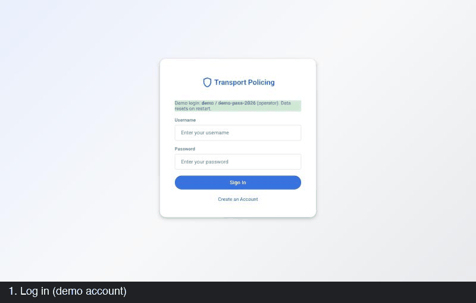
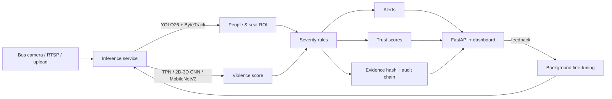
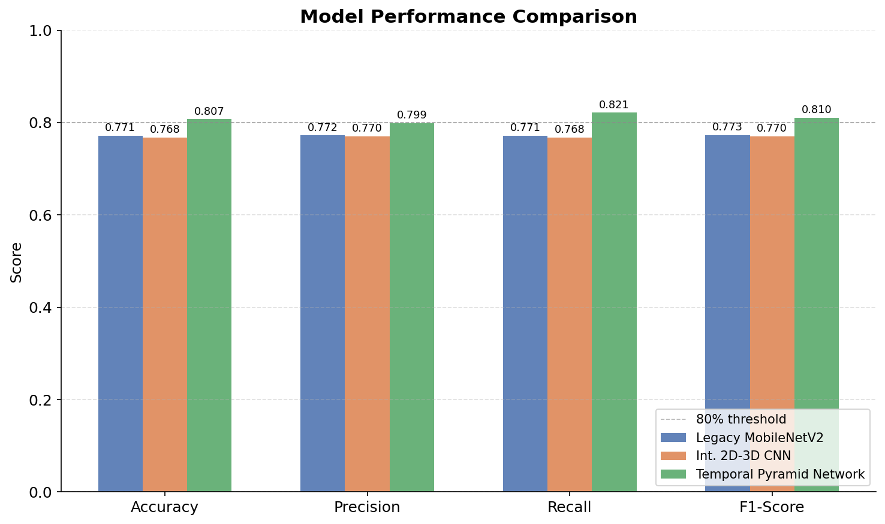

# Transport Policing System

[](https://github.com/RAZORRZR0/bus-safety-ai/actions/workflows/ci.yml)

AI video monitoring for city buses. It watches a camera feed or uploaded clip, detects **violence** and **reserved-seat misuse**, raises alerts, keeps a **tamper-evident evidence trail**, and scores every bus, route and timeslot on how safe it has been.

Final-year project. FastAPI backend, PyTorch models, YOLO person tracking, and a web dashboard.



## What it does

| Area | How |
|---|---|
| Violence detection | 16-frame clips scored by one of three video classifiers (below), switchable at runtime |
| People & seats | YOLO26 + ByteTrack count and track passengers; a configurable reserved-seat region flags misuse |
| Alerts & severity | Rule engine turns model scores into `low / medium / high / critical` events and opens alerts |
| Trust scores | Each event lowers a 0–100 score for its bus, route and timeslot, so operators see where to send staff |
| Evidence integrity | Every clip is SHA-256 hashed; every action is appended to a hash chain, so any edit breaks the chain |
| Feedback loop | Operators mark false positives/negatives; the violence model fine-tunes on them in the background |
| Security | JWT + TOTP two-factor login, `admin` / `operator` roles, login throttling, input validation, upload limits, scoped short-lived stream tokens |
| Live mode | Webcam, RTSP or uploaded video streamed back as annotated MJPEG |

## Architecture



More detail: [docs/architecture.md](docs/architecture.md) and the maths behind each step in [docs/algorithm_formulas.md](docs/algorithm_formulas.md).

## Results

Trained and tested on the Bus Violence benchmark (1,400 clips filmed inside a moving bus; 280-clip test split).

| Model | Params | Accuracy | Precision | Recall | F1 |
|---|---|---|---|---|---|
| MobileNetV2 + temporal mean-pool | 2.2 M | 77.5% | 76.6% | 79.3% | 77.9% |
| Integrated 2D-3D CNN | 1.1 M | 77.1% | 76.8% | 77.9% | 77.3% |
| **Temporal Pyramid Network** | 13.0 M | **81.1%** | **80.9%** | **81.4%** | **81.1%** |

Measured with [scripts/evaluate.py](scripts/evaluate.py) on CPU (raw output: [metrics.json](research_plots/metrics.json)). The TPN gets 114 of 140 violent clips and 113 of 140 normal clips right.



The TPN is the default. Training code: [train_violence.py](train_violence.py) (Bus Violence train/test split) and [kaggle_train_violence.py](kaggle_train_violence.py) (multi-dataset variant for Kaggle GPUs). To reproduce the table, put the dataset in `bus-violence/` and run:

```bash
python scripts/evaluate.py     # writes research_plots/metrics.json
python generate_plots.py       # redraws the plots from it
```

## Run it

**Docker**

```bash
docker build -t bus-safety-ai .
docker run -p 8000:8000 -e JWT_SECRET=change-me bus-safety-ai
```

**Locally** (Python 3.12)

```bash
pip install -r requirements.txt
sh scripts/download_models.sh        # trained weights from the GitHub Release
cp .env.example .env                 # then set JWT_SECRET
uvicorn app.main:app --reload
```

Open <http://127.0.0.1:8000/dashboard>, register (the first account may be `admin`), add the 2FA secret to an authenticator app, and log in. YOLO weights download automatically on first run.

Settings come from environment variables: see [.env.example](.env.example). Set `REQUIRE_2FA=false` for a quick local demo.

**Demo mode**: set `DEMO_MODE=true` to seed a `demo` operator login and a sample fleet (the login page shows the credentials). [deploy/huggingface/](deploy/huggingface/) has a ready Dockerfile for a Hugging Face Docker Space (needs a paid HF plan) that builds from this repo in demo mode. The app needs about 2 GB of RAM because of PyTorch.

## Tests

```bash
pip install -r requirements-dev.txt
pytest -q
```

The 20 tests cover login and 2FA, login throttling, role checks, input validation (IDs that try HTML or file paths are rejected), upload limits, stream tokens, event ingestion → alert → trust score, the severity rules, and audit-chain tamper detection. They run on every push in GitHub Actions.

## Security notes

- A password alone gets a 5-minute token that can only finish 2FA. Only a token from the 2FA step can call the API.
- The live stream uses a separate 60-second token, because an `` tag can't send an `Authorization` header. That token can't call the API.
- Bus, route and timeslot IDs are limited to letters, digits and `_ . : -`, so they can't break HTML or become file paths. The dashboard also escapes all server data.
- Changing models or ROI, deleting fleet data and reading the audit chain are admin-only.
- `/admin/audit-chain` recomputes every hash and reports the first tampered entry.
- Fine-tuning from feedback writes a new `finetuned_*.pth` and never overwrites the shipped model.

## API (main endpoints)

| Method | Path | Purpose |
|---|---|---|
| POST | `/auth/register`, `/auth/login`, `/auth/verify-2fa` | Accounts and two-step login |
| POST | `/scan/video` | Run all models on an uploaded clip |
| POST, GET | `/stream/token`, `/stream/live?source=0&token=…` | Annotated live stream |
| POST | `/ingest/event`, `/ingest/frame` | Push events or frames from a bus |
| GET | `/alerts`, `/events`, `/trust/overview` | Dashboard data |
| POST | `/feedback` | Correct a prediction (feeds retraining) |
| GET | `/admin/audit-chain` | Verify the evidence chain |

Interactive docs at `/docs` when the server is running.

## Data and references

The dataset is not in this repo. Get it from its authors:

- L. Ciampi et al., *Bus Violence: An Open Benchmark for Video Violence Detection on Public Transport*, Sensors 22(21), 2022. [doi:10.3390/s22218345](https://doi.org/10.3390/s22218345)

Other papers this work draws on:

- J. Barthelemy et al., *Safety After Dark: A Privacy Compliant and Real-Time Edge Computing Intelligent Video Analytics for Safer Public Transportation*, Sensors 24(24), 2024. [doi:10.3390/s24248102](https://doi.org/10.3390/s24248102)
- W. Getsopon et al., *Int.2D-3D-CNN: Integrated 2D and 3D Convolutional Neural Networks for Video Violence Recognition*, Mathematics 13(16), 2025. [doi:10.3390/math13162665](https://doi.org/10.3390/math13162665)
- B. Qi et al., *Automated violence monitoring system for real-time fistfight detection using deep learning-based temporal action localization*, Scientific Reports 15, 2025. [doi:10.1038/s41598-025-12531-4](https://doi.org/10.1038/s41598-025-12531-4)

The full write-up is in [docs/research_paper.md](docs/research_paper.md).

## Limitations

- Accuracy is around 81% on a single dataset filmed with actors; real CCTV footage will need more data.
- Seat-misuse checks rely on gender estimation from faces (DeepFace). That is error-prone on low-resolution CCTV and raises privacy concerns, so it should stay a hint for a human operator, never an automatic penalty.
- SQLite and in-process background jobs suit a demo, not a fleet; production would move to Postgres and a job queue.
