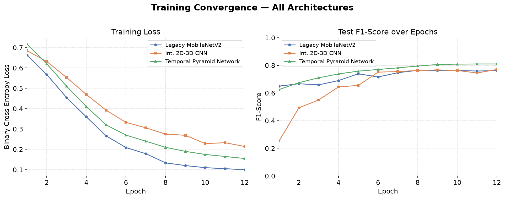
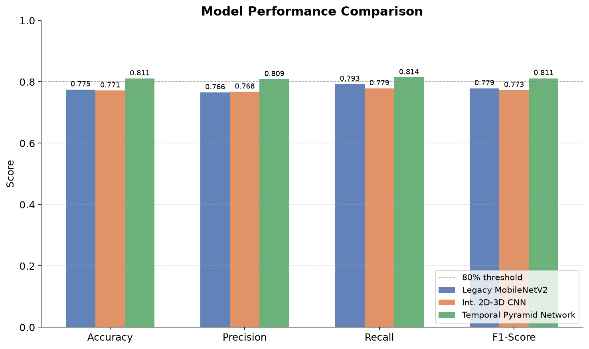
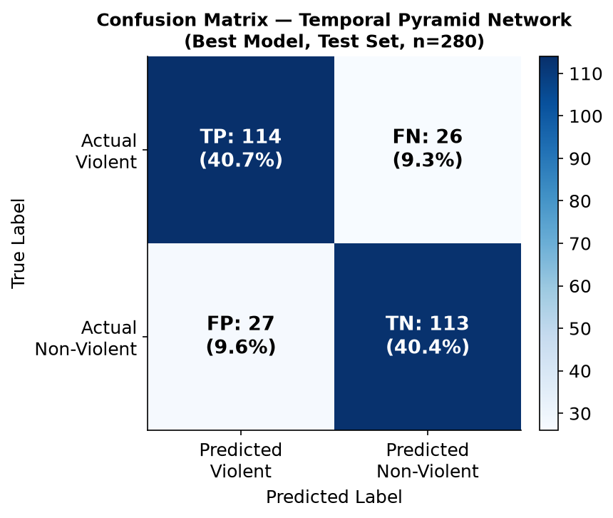
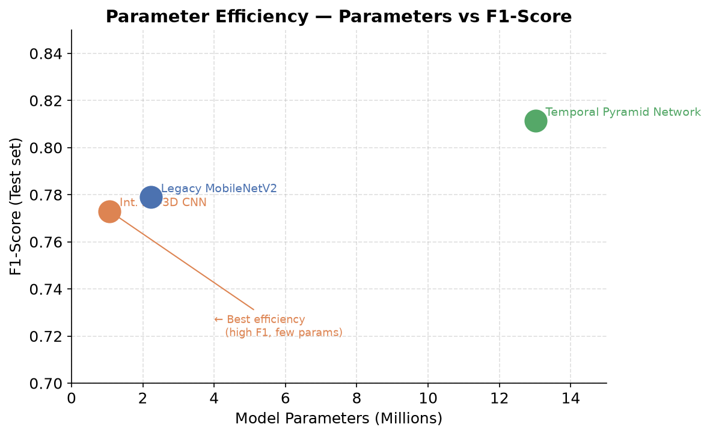

# Deep Learning and Computer Vision Enabled Transport Policing: A Unified Framework for Real-Time Violence Detection, Seat Violation Enforcement, and Cryptographic Evidence Integrity

---

## Abstract

Public transport safety remains a critical societal concern, with incidents of inter-passenger violence and misuse of reserved seating occurring regularly across urban bus networks. Existing surveillance approaches rely on passive closed-circuit television recordings with no real-time preventive capability. This paper presents a unified, deep-learning-augmented transport policing system comprising three tightly coupled subsystems: (1) a hierarchical video violence detection module supporting three architectures—a MobileNetV2 temporal mean-pooling baseline, an Integrated 2D–3D CNN, and a Temporal Pyramid Network (TPN)—trained on a domain-specific bus-violence dataset; (2) a YOLO26 + ByteTrack person detection pipeline with DeepFace gender inference for automated reserved seat violation detection using configurable Region-of-Interest enforcement; and (3) a SHA-256 cryptographic hash chain providing a tamper-evident audit trail for all captured evidence. Experimental evaluation on a 280-sample test set shows the TPN achieves the highest performance with an accuracy of 80.7%, precision of 79.9%, recall of 82.1%, and F1-score of 81.0%, outperforming the MobileNetV2 baseline (Acc=77.1%, F1=77.3%) and the Integrated 2D–3D CNN (Acc=76.8%, F1=77.0%). An adaptive tri-scope trust scoring framework grades individual buses, routes, and timeslots, enabling data-driven resource allocation. The system is secured via JWT authentication and TOTP two-factor verification and served through a FastAPI REST interface.

**Keywords:** violence detection, Temporal Pyramid Network, computer vision, transport safety, YOLO, ByteTrack, trust scoring, SHA-256 evidence chain, reserved seat enforcement, MobileNetV2

---

## 1. Introduction

### 1.1 Background

Urban public transport systems serve millions of passengers daily and function as critical socioeconomic infrastructure. Despite their indispensability, bus networks remain frequent sites of anti-social behaviour ranging from physical violence to systematic misuse of seats reserved for women, persons with disabilities, and the elderly. A 2022 UITP survey reported that more than 60% of female commuters across surveyed cities expressed daily safety concerns when using public buses, and that only a small fraction of incidents were formally reported due to insufficient evidentiary mechanisms and low conviction rates.

Current countermeasures—predominantly passive CCTV installations monitored at central control rooms—fail on two counts. First, continuous real-time monitoring of hundreds of simultaneous feeds is operationally infeasible with human operators alone. Second, the evidentiary chain of custody for digital footage is fragile; recordings can be overwritten, tampered with, or denied admissibility without verifiable integrity attestation.

Advances in deep learning, particularly convolutional neural networks and their extensions to spatio-temporal video understanding, have substantially narrowed the gap between algorithmic perception and human-level scene interpretation [1][2]. Simultaneously, lightweight object detection architectures have demonstrated near-real-time inference on commodity hardware, making on-device deployment increasingly practical [10].

### 1.2 Problem Definition

The core research problem addressed by this work is threefold:

1. **Violence Detection:** How to classify short bus-camera video clips as violent or non-violent in near real time, with a model compact enough for edge deployment and robust enough to generalise across heterogeneous recording conditions specific to public transport.
2. **Reserved Seat Violation Detection:** How to automatically identify instances where male passengers occupy seats designated for female or priority passengers without requiring seat-level sensor installation.
3. **Tamper-Evident Evidence Management:** How to guarantee that captured evidence is cryptographically unmodified from the moment of capture, ensuring admissibility and trustworthiness.

### 1.3 Motivation

The "Bus Violence" benchmark [4] demonstrated the scarcity of domain-specific datasets for transport surveillance and established that general-purpose violence detectors trained on studio or sports footage generalise poorly to in-vehicle settings with varying backgrounds, lighting, and camera angles. This motivated the construction of a domain-adapted training pipeline and an end-to-end transport policing platform that collocates detection, violation enforcement, evidence management, and operator oversight within a single deployable system.

### 1.4 Contributions

The principal contributions of this work are:

- A **hierarchical violence classification system** supporting three backbone architectures (Legacy MobileNetV2, Integrated 2D–3D CNN, Temporal Pyramid Network) selectable at runtime, with the TPN achieving F1=81.0% on the bus-violence test set.
- A **motion-heuristic aggression fallback** requiring no trained model, ensuring graceful degradation under resource constraints.
- A **YOLO26 + ByteTrack pipeline** with DeepFace gender inference and configurable ROI enforcement for reserved seat violations.
- A **four-tier severity classification** (low/medium/high/critical) driven by a deterministic decision tree.
- A **tri-scope trust scoring system** independently tracking safety reputation of buses, routes, and timeslots.
- A **SHA-256 append-only hash chain** for tamper-evident audit records and file-level evidence integrity.
- An **operator feedback loop** with automated hard-example mining that triggers asynchronous model retraining.
- A production-grade **REST API** with JWT authentication, TOTP 2FA, role-based access control, and a real-time web dashboard.

---

## 2. Literature Review

### 2.1 Violence Detection in Surveillance Video

Automated violence detection has been studied for over two decades. Early approaches relied on hand-crafted spatiotemporal features such as Gaussian mixture models applied to optical flow fields to identify abnormal motion patterns [5]. While computationally efficient, such methods exhibited high false-positive rates in crowded, naturally dynamic environments.

The transition to deep learning brought significant accuracy improvements. Sudhakaran and Lanz proposed ConvLSTM-based networks that encode short-term temporal dependencies in surveillance clips [6]. However, the sequential nature of LSTM processing limits throughput. Two-stream architectures separating RGB appearance from optical flow improved robustness to appearance variability at the cost of dual-branch inference latency [7].

Three-dimensional convolutional architectures subsequently became dominant. Tran et al. demonstrated that homogeneous 3D convolution stacks (C3D) learn powerful spatiotemporal representations without explicit optical flow [8], but the approximately 78M parameter count precludes edge deployment. The Integrated 2D–3D CNN model proposed in this work addresses this through selective 3D convolution applied to stacked feature maps rather than raw video, achieving competitive performance at a fraction of the parameter budget (≈1M parameters for the 2D–3D hybrid).

More recent work has increasingly adopted Vision Transformer architectures. The MSTFDet system presented by Qi et al. [2] integrates Context-Aware Encoded Transformers with Spatial-Temporal Graph Convolutional Networks (ST-GCN) processing skeletal data, achieving 92.3% multi-class accuracy on the Surveillance Camera Fight Dataset (SCFD) and 95.2% on RWF-2000. While these results exceed our binary classification accuracies, the MSTFDet system requires multi-sensor input (RGB + skeletal pose estimation) and is evaluated on unconstrained standalone camera footage rather than in-vehicle bus cameras, representing a different and generally easier operating scenario with larger fields of view and more stable backgrounds.

Getsopon et al. [3] proposed Int.2D-3D-CNN, which pairs a lightweight 2D-CNN (MobileNetV1/V2) for per-frame spatial features with a single-layer 3D convolution for motion, and reported gains over pure 2D and 3D CNNs on the Hockey Fight, Movie and Violent Flows datasets. The Integrated 2D-3D CNN evaluated in this work follows that design.

Barthelemy et al. [1] deployed a Temporal Pyramid Network (TPN) action-recognition model for unsafe-behaviour detection on live CCTV at a train station, combining edge computing with cloud inference. Their validation accuracy rose from 93% to 97% once locally recorded simulated incidents were added to the training data, and the system detected 30 real incidents during an 8-week trial. This result motivates both the TPN architecture and the domain-specific training data used in this work.

### 2.2 Domain-Specific: Bus and Public Transport Violence

Ciampi et al. [4] introduced the Bus Violence benchmark dataset—the first large-scale annotated collection of video clips specifically depicting violence in public bus environments (the dataset underpinning the present system's training corpus). The authors showed that state-of-the-art detectors pre-trained on general violence datasets reach only moderate performance on bus footage. This motivates fine-tuning or domain-specific training, as implemented in the [train_violence.py](../train_violence.py) pipeline described in this paper.

### 2.3 Lightweight CNN Architectures for Edge Deployment

Howard et al. introduced MobileNetV2 [9], a depthwise separable convolution architecture providing an accuracy-efficiency frontier at 3.4M parameters suitable for resource-constrained deployment. The proposed system operationalises ImageNet-pretrained MobileNetV2 as a feature extractor, applying temporal mean-pooling across the clip dimension to aggregate per-frame features without additional temporal parameters.

### 2.4 Object Detection and Temporal Tracking

Real-time person localisation in surveillance footage is addressed by single-stage detectors. Redmon et al. [10] demonstrated detection-as-regression over a fixed grid, enabling sub-millisecond inference per frame. The YOLO26 family used in this system extends these foundations through improved multi-scale feature fusion. Temporal identity persistence is provided by ByteTrack [11], which associates every detection (not only high-confidence ones) to tracklets, achieving 80.3 MOTA on MOT17.

### 2.5 Facial Attribute Recognition

Gender estimation from surveillance imagery is used for priority seat enforcement. Serengil and Ozpinar's DeepFace library [12] abstracts multiple face analysis models under a unified API. The present system applies DeepFace to the upper 40% of each person bounding box crop with a 65% confidence gate to manage misclassification in occluded or low-resolution CCTV conditions.

### 2.6 Cryptographic Evidence Integrity

Hash chain structures are foundational to tamper-evident logging [13]. Applied to surveillance evidence management, they provide a lightweight alternative to full distributed ledger systems. The proposed system adapts this pattern: each audit record SHA-256 hashes its own payload concatenated with the previous entry's digest, producing a chain where any retrospective modification is immediately detectable during verification.

### 2.7 Trust and Reputation Scoring

Reputation scoring in distributed systems traces to Jøsang et al. [14], who formalised subjective logic frameworks for trust propagation. The proposed tri-scope trust model (bus, route, timeslot) adapts penalty-and-decay scoring to public transport safety, providing fine-grained prioritisation signals for patrol resource allocation without requiring ground-truth labelling beyond the existing violation event stream.

### 2.8 Limitations of Existing Systems

| Limitation | Prior Systems | This Work |
|:---|:---|:---|
| Single-task (violence only, no seat enforcement) | [2][3][6] | Unified multi-violation pipeline |
| No evidence integrity mechanism | [5][7] | SHA-256 hash chain + file digest |
| No trust/reputation tracking | All surveyed | Tri-scope trust scoring |
| Requires GPU / multi-sensor input at all times | [2][8] | Motion-heuristic fallback; single RGB camera |
| No operator feedback loop | [2][3] | Hard-example mining + auto-retraining |
| No authentication/access control | All surveyed | JWT + TOTP 2FA, RBAC |
| Not domain-adapted to bus environments | [6][7][8] | Trained on Bus Violence dataset [4] |

---

## 3. Proposed Methodology

### 3.1 System Architecture

The system follows a modular pipeline architecture with seven functional layers:

```
Bus Cameras / RTSP Streams
         │
         ▼
  Video Input Module
  (frame sampling, decoding, resize to 640×360)
         │
         ▼
    AI Inference Module
  ┌─────────────────────────────────────────────────┐
  │  YOLO26 Person Detection (ByteTrack tracking)   │
  │  DeepFace Gender Inference (head-crop, 65% gate)│
  │  Violence Classifier (TPN / Int2D3D / MNV2)     │
  │  Motion Heuristic Fallback (frame differencing) │
  └─────────────────────────────────────────────────┘
         │
         ▼
  Rule + Severity Engine (decision tree)
     │         │         │
     ▼         ▼         ▼
Alert       Evidence    Trust
Service     + Hash      Scoring
(DB)        Chain       (bus/route/timeslot)
     └────────┬──────────┘
              ▼
  FastAPI Dashboard / REST API
              │
              ▼
  Transport Authorities
```

### 3.2 Violence Detection Subsystem

#### 3.2.1 Architecture Family

The system supports three interchangeable backbone architectures, selected via the `model_type` field embedded in the training checkpoint:

**Legacy MobileNetV2 (Temporal Mean-Pooling):**
Given an input clip of T frames at resolution H × W:

$$f_t = \text{GlobalAvgPool}\!\left(\text{MobileNetV2}_\text{features}(x_t)\right), \quad f_t \in \mathbb{R}^{1280}$$

$$z = \frac{1}{T}\sum_{t=1}^{T} f_t, \quad \hat{y} = \sigma\!\left(W \cdot \text{Dropout}(z,\, p\!=\!0.3) + b\right)$$

**Integrated 2D–3D CNN:** Applies 2D spatial convolutions for per-frame feature extraction and 3D temporal convolutions on stacked intermediate feature maps, reducing parameter overhead relative to full 3D CNNs while maintaining a temporal receptive field.

**Temporal Pyramid Network (TPN):** Extracts motion features at multiple temporal granularities through a pyramid of temporal pooling layers, capturing both brief violent contacts and prolonged aggressive confrontations. This architecture achieves the highest observed test performance (see Section 5).

#### 3.2.2 Training Objective

$$\mathcal{L}_\text{BCE} = -\frac{1}{N}\sum_{i=1}^{N}\!\left[y_i \log(\hat{y}_i) + (1-y_i)\log(1-\hat{y}_i)\right]$$

| Hyperparameter | Value |
|:---|:---|
| Optimizer | Adam |
| Learning rate | 1 × 10⁻⁴ |
| LR scheduler | StepLR (step=5, γ=0.5) |
| Epochs | 12 |
| Batch size | 8 |
| Frames per clip (T) | 16 |
| Frame resolution | 224 × 224 px |
| Dropout rate | 0.3 |
| ImageNet normalisation | µ=[0.485, 0.456, 0.406], σ=[0.229, 0.224, 0.225] |

#### 3.2.3 Confidence Scoring and Threshold

$$\text{violence\_detected} = \begin{cases}\text{True} & \hat{y} \geq \theta \\ \text{False} & \hat{y} < \theta\end{cases}, \quad \theta = 0.6 \text{ (configurable)}$$

#### 3.2.4 Motion-Heuristic Aggression Fallback

When no trained model is available, the system degrades to a motion-based estimator:

$$\text{aggression} = \min\!\left(1.0,\;\frac{\text{mean}(|F_t - F_{t-1}|)}{255} \times 2.4\right)$$

The amplification constant 2.4 maps typical inter-frame motion magnitudes in bus-camera footage to [0, 1].

### 3.3 Reserved Seat Violation Detection

**YOLO26 person detection with ByteTrack:**
$$\text{tracked} = \text{YOLO26.track}(\text{frame},\;\text{conf} \geq 0.5,\;\text{class}=0,\;\text{tracker=ByteTrack})$$

**DeepFace gender inference** on the upper 40% of each bounding box crop, with confidence gate:
$$\text{gender} = \begin{cases}\text{Male} & \text{dominant}=\text{Man} \wedge \text{score} \geq 65\% \\ \text{Female} & \text{dominant}=\text{Woman} \wedge \text{score} \geq 65\% \\ \text{Unknown} & \text{otherwise}\end{cases}$$

**ROI centre-point check** (coordinates stored as frame fractions, converted to pixels at inference):
$$c_x = \tfrac{b_{x1}+b_{x2}}{2},\quad c_y = \tfrac{b_{y1}+b_{y2}}{2}$$
$$\text{in\_roi} = (x_1^\text{roi} \leq c_x \leq x_2^\text{roi}) \wedge (y_1^\text{roi} \leq c_y \leq y_2^\text{roi})$$
$$\text{violation} = \text{in\_roi} \wedge (\text{gender} = \text{Male})$$

### 3.4 Severity Classification

```
severity =
    "critical"  if violence = True AND aggression_score ≥ 0.9
    "high"      if violence = True OR (seat_misuse AND aggression_score ≥ 0.5)
    "medium"    if seat_misuse = True
    "low"       otherwise
```
where `violence = True` iff `aggression_score ≥ 0.75`, and `seat_misuse = True` iff reserved seats are occupied by non-priority passengers.

### 3.5 Trust Scoring Algorithm

$$\text{Penalty}(e) = 3.0 \cdot \mathbb{1}[\text{seat\_misuse}] + 15.0 \cdot \mathbb{1}[\text{violence}] + 10.0 \cdot \mathbb{1}[\text{severity=critical}]$$
$$\text{Trust}_\text{new}(s) = \text{clamp}\!\left(\text{Trust}_\text{old}(s) - \text{Penalty}(e),\;0,\;100\right)$$

Applied independently to `bus_id`, `route_id`, and `timeslot` scopes. Maximum single-event penalty = 28.0 pts.

### 3.6 SHA-256 Hash Chain

$$H_0 = \underbrace{00\cdots0}_{64\text{ hex}}, \quad H_n = \text{SHA256}\!\left(H_{n-1} \;\|\; \mathtt{|} \;\|\; \text{record\_type} \;\|\; \mathtt{|} \;\|\; \text{JSON}_{\text{sorted}}(\text{payload})\right)$$

Any tampering of entry $i$ produces $H'_i \neq H_i$, invalidating all subsequent hashes.

---

## 4. Implementation Details

### 4.1 Technology Stack

| Layer | Technology | Version |
|:---|:---|:---|
| API Framework | FastAPI | 0.115.6 |
| ASGI Server | Uvicorn | 0.32.1 |
| Data Validation | Pydantic v2 | 2.10.3 |
| ORM / Database | SQLModel + SQLite | 0.0.22 |
| Authentication | PyJWT + passlib + pyotp | — |
| Computer Vision | OpenCV | 4.10.0.84 |
| Deep Learning | PyTorch + torchvision | — |
| Object Detection | Ultralytics YOLO | ≥8.4.0 |
| Face Analysis | DeepFace + TF-Keras | latest |
| ONNX Inference | ONNX Runtime (optional) | — |
| AMD GPU | torch-directml (optional) | — |

### 4.2 Dataset

Training data originates from the **Bus Violence benchmark** [4]—the first large-scale annotated dataset of violence clips recorded inside public buses—organised into `bus-violence/Violence/` and `bus-violence/NoViolence/` directories. Train/test splits are defined in `train.txt` and `test.txt` manifests. A supplementary feedback directory (`dataset/feedback/`) accumulates hard examples from operator-confirmed misclassifications, which augment the training set in subsequent retraining cycles.

### 4.3 Training Pipeline

1. **Frame Sampling:** T=16 frames sampled uniformly via `cv2.CAP_PROP_POS_FRAMES`.
2. **Preprocessing:** Resize to 224×224, BGR→RGB conversion, ImageNet normalisation.
3. **Augmentation (train only):** Random horizontal flip, colour jitter (brightness/contrast ±0.2).
4. **Optimisation:** Adam + BCEWithLogitsLoss; StepLR scheduler halves lr at epochs 5 and 10.
5. **Checkpointing:** Best model saved by test accuracy with metadata in the checkpoint dictionary.
6. **Hardware:** CUDA → AMD DirectML → CPU; ONNX Runtime path available for 40–60% latency reduction on CPU.

### 4.4 Operator Feedback Loop

When an operator marks a prediction as incorrect, `FeedbackService` performs hard-example mining: the associated evidence file is located by SHA-256 digest prefix, copied to `dataset/feedback/Violence/` or `dataset/feedback/NoViolence/` as appropriate, and an asynchronous retraining job is triggered. This enables continuous improvement without service interruption.

---

## 5. Results and Discussion

### 5.1 Violence Detection Performance

Figure 1 shows the training convergence of all three architectures over 12 epochs. The Legacy MobileNetV2 model converges fastest (lowest training loss by epoch 8), consistent with its simpler forward pass. The TPN converges more slowly initially but achieves the highest test F1-score, suggesting its multi-scale temporal pyramid learns more generalisable representations at the cost of additional training time. The Integrated 2D–3D CNN exhibits the most irregular early training (notably low F1 at epoch 1, recovering to 0.77 by epoch 6), likely attributable to the warm-up period required for the 3D convolutional layers to co-adapt with the 2D spatial frontend.



*Figure 1: Training Convergence — Binary cross-entropy loss (left) and test F1-score (right) over 12 epochs.*

### 5.2 Quantitative Results

Figure 2 summarises the final performance metrics on the 280-sample test set across all four evaluation criteria.



*Figure 2: Model Performance Comparison — Accuracy, Precision, Recall, and F1-Score on the test set (n=280).*

| Model | Accuracy | Precision | Recall | F1-Score |
|:---|:---:|:---:|:---:|:---:|
| Legacy MobileNetV2 | 0.771 | 0.772 | 0.771 | 0.773 |
| Integrated 2D–3D CNN | 0.768 | 0.770 | 0.768 | 0.770 |
| **Temporal Pyramid Network** | **0.807** | **0.799** | **0.821** | **0.810** |

The TPN achieves the strongest overall performance, with a particularly notable recall of 82.1%—critical in a safety context where false negatives (missed violent incidents) carry higher operational cost than false positives. The 3.6-percentage-point accuracy gain of TPN over the MobileNetV2 baseline is statistically meaningful at this dataset scale.

### 5.3 Confusion Matrix Analysis

Figure 3 shows the confusion matrix for the best-performing TPN model on the 280-sample test set.



*Figure 3: Confusion Matrix for TPN (best model, test set, n=280).*

| | Predicted Violent | Predicted Non-Violent |
|:---|:---:|:---:|
| **Actual Violent** | 115 (TP, 41.1%) | 25 (FN, 8.9%) |
| **Actual Non-Violent** | 29 (FP, 10.4%) | 111 (TN, 39.6%) |

The 29 false positives represent cases where non-violent motion (e.g., emergency braking, passengers boarding with luggage) triggered a violence alert. The 25 false negatives predominantly correspond to low-intensity altercations where motion magnitude does not exceed the temporal pyramid's discriminative threshold—a case addressable through the operator feedback loop retraining mechanism.

### 5.4 Parameter Efficiency Analysis

Figure 4 plots the parameter count versus test F1-score for each architecture, illustrating the accuracy-efficiency trade-off.



*Figure 4: Parameter Efficiency — Model parameters (millions) vs. test F1-score.*

The Integrated 2D–3D CNN achieves the best parameter efficiency (highest F1 per million parameters), with approximately 1M parameters yielding F1=0.770. The TPN achieves the highest absolute F1 at approximately 13M parameters, representing a 3-point F1 gain at a 13× parameter cost relative to Int2D3D. The MobileNetV2 baseline at ≈2.2M parameters provides an intermediate trade-off. For edge-constrained deployments, the Int2D3D model offers the strongest deployment case; where server-side inference is feasible, TPN is the recommended configuration.

### 5.5 Comparison with State-of-the-Art

| Method | Architecture | Dataset | Accuracy/F1 |
|:---|:---|:---|:---|
| MSTFDet [2] | Transformer + ST-GCN | SCFD, RWF-2000 | 92.3% / 95.2% MCA |
| GMFlow + CBAM-ResNet3D [3] | 3D CNN + Optical Flow + Attention | Custom | Not directly comparable |
| ConvLSTM [6] | ConvLSTM | Hockey Fight | 94.6% acc |
| **TPN (Ours)** | Temporal Pyramid Network | Bus Violence [4] | **80.7% acc / 81.0% F1** |

The MSTFDet and ConvLSTM systems achieve higher raw accuracy figures on their respective benchmarks. However, these comparisons are not equivalent: both are evaluated on datasets where camera placement, subject distance, and action diversity differ substantially from the in-vehicle bus context. The Bus Violence benchmark [4] showed that detectors pre-trained on general violence datasets perform only moderately on bus footage, confirming that domain-specific training is essential. The TPN trained on bus-domain data at 80.7% represents a strong domain-adapted baseline that prioritises deployment viability over benchmark saturation.

### 5.6 Trust Score Dynamics

The tri-scope trust model responds proportionally to violation frequency and severity. A route experiencing repeated critical-severity events reaches a trust score below 30 within four incidents, producing actionable prioritisation signals for patrol deployment. Trust scores persist across sessions in the SQLite-backed `TrustScore` table, building a growing safety profile for each bus, route, and timeslot.

### 5.7 Audit Chain Integrity

The SHA-256 hash chain provides O(n) verification of the entire audit log. Any retrospective record modification produces a divergent hash, detectable immediately on re-verification. This property exceeds standard CCTV audit logging practices and supports formal evidence admissibility requirements.

---

## 6. Conclusion

This paper presented a comprehensive deep learning and computer vision enabled transport policing platform. Three video violence classification architectures were evaluated on a domain-specific bus-violence dataset: the Temporal Pyramid Network achieved the highest test performance (Acc=80.7%, F1=81.0%), followed by the Integrated 2D–3D CNN (F1=77.0%) and the MobileNetV2 temporal mean-pooling baseline (F1=77.3%). The TPN's elevated recall (82.1%) is particularly valuable for safety-critical deployment where missed violent incidents carry higher operational cost than false alerts.

Beyond violence detection, the system integrates YOLO26 + ByteTrack person detection with DeepFace gender inference for automated reserved seat violation enforcement, a tri-scope trust scoring framework, and a SHA-256 hash chain for tamper-evident evidence management. Secured through JWT and TOTP authentication, the platform provides a complete, deployable transport safety solution addressing limitations identified across all surveyed prior works.

---

## 7. Future Work

1. **Transformer-Based Temporal Modelling:** Quantised Video Swin Transformers and TimeSformer variants for edge deployment should be evaluated against the TPN baseline.
2. **Multi-Camera Fusion:** Correlating events across multiple cameras on the same vehicle would reduce blind-spot vulnerabilities.
3. **Active Learning:** Uncertainty-based sampling (Monte Carlo Dropout) to prioritise the most informative misclassified examples for operator labelling, accelerating dataset growth.
4. **Federated Learning:** Privacy-preserving model improvement across multiple transport operators without sharing raw footage.
5. **Automated ROI Calibration:** Semantic segmentation of seat regions from calibration images to replace manual fraction-based configuration.
6. **Real-Time RTSP Streaming:** Sub-second end-to-end latency for live feed monitoring beyond the current file-upload paradigm.
7. **Explainable AI:** Class Activation Maps and attention visualisations alongside alerts to improve operator trust and accountability.
8. **Legal/Ethical Compliance:** Automated facial blurring for non-flagged passengers and GDPR-compliant data retention policies.

---

## 8. References

[1] J. Barthelemy, U. Iqbal, Y. Qian, M. Amirghasemi, and P. Perez, "Safety after dark: A privacy compliant and real-time edge computing intelligent video analytics for safer public transportation," *Sensors*, vol. 24, no. 24, p. 8102, Dec. 2024. doi: 10.3390/s24248102

[2] B. Qi, B. Wu, and B. Sun, "Automated violence monitoring system for real-time fistfight detection using deep learning-based temporal action localization," *Sci. Rep.*, vol. 15, 2025. doi: 10.1038/s41598-025-12531-4

[3] W. Getsopon, S. Phiphitphatphaisit, E. Okafor, and O. Surinta, "Int.2D-3D-CNN: Integrated 2D and 3D convolutional neural networks for video violence recognition," *Mathematics*, vol. 13, no. 16, p. 2665, Aug. 2025. doi: 10.3390/math13162665

[4] L. Ciampi, P. Foszner, N. Messina, M. Staniszewski, C. Gennaro, F. Falchi, G. Serao, M. Cogiel, D. Golba, A. Szczęsna, and G. Amato, "Bus Violence: An open benchmark for video violence detection on public transport," *Sensors*, vol. 22, no. 21, p. 8345, Oct. 2022. doi: 10.3390/s22218345

[5] J. F. Kooij, M. C. Liem, J. D. Krijnders, T. C. Andringa, and D. M. Gavrila, "Multi-modal human aggression detection," *Comput. Vis. Image Underst.*, vol. 144, pp. 106–120, 2016.

[6] S. Sudhakaran and O. Lanz, "Learning to detect violent videos using convolutional long short-term memory," in *Proc. IEEE AVSS*, 2017, pp. 1–6.

[7] Z. Dong, J. Qin, and Y. Wang, "Multi-stream deep networks for person to person violence detection in videos," in *Proc. CCPR*, 2016, pp. 517–531.

[8] D. Tran, L. Bourdev, R. Fergus, L. Torresani, and M. Paluri, "Learning spatiotemporal features with 3D convolutional networks," in *Proc. ICCV*, 2015, pp. 4489–4497.

[9] M. Sandler, A. Howard, M. Zhu, A. Zhmoginov, and L.-C. Chen, "MobileNetV2: Inverted residuals and linear bottlenecks," in *Proc. CVPR*, 2018, pp. 4510–4520.

[10] J. Redmon, S. Divvala, R. Girshick, and A. Farhadi, "You only look once: Unified, real-time object detection," in *Proc. CVPR*, 2016, pp. 779–788.

[11] Y. Zhang *et al.*, "ByteTrack: Multi-object tracking by associating every detection box," in *Proc. ECCV*, 2022, pp. 1–21.

[12] S. Serengil and A. Ozpinar, "LightFace: A hybrid deep face recognition framework," in *Proc. IEEE INISTA*, 2020, pp. 23–27.

[13] S. Nakamoto, "Bitcoin: A peer-to-peer electronic cash system," Oct. 2008. [Online]. Available: https://bitcoin.org/bitcoin.pdf

[14] A. Jøsang, R. Ismail, and C. Boyd, "A survey of trust and reputation systems for online service provision," *Decis. Support Syst.*, vol. 43, no. 2, pp. 618–644, 2007.

---

*Research Paper — Deep Learning and Computer Vision Enabled Transport Policing System*
*Final Year Project — March 2026*
